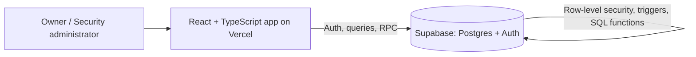

# SecureStart

**SecureStart helps small South African professional firms find their cybersecurity and POPIA gaps, turn each gap into a tracked fix, and show how their security is improving.**

| | |
|---|---|
| **Live app** | https://secure-start-ten.vercel.app/ |
| **Stitch designs** | [Stitch project](https://stitch.google.com/preview/6779133449834683870) (exports in [docs/designs/](./docs/designs/)) |
| **Loom pitch and demo** | PASTE LOOM LINK |
| **Test logins** | Owner: EMAIL / PASSWORD · Administrator: EMAIL / PASSWORD |
| **Portfolio** | https://portfolio-zeta-lake-10.vercel.app/ ([repo](https://github.com/codingwithlebo/portfolio)) |
| **Repo** | https://github.com/codingwithlebo/SecureStart |
## The problem

Accounting, law and medical practices hold client personal information but have no security team. Under POPIA every security compromise must be reported, the Information Regulator is moving into enforcement, and most firms track their security in a spreadsheet, if at all. Full business case and sources: [BUSINESS.md](./BUSINESS.md).

## What it does

A firm answers a guided assessment of 30 questions based on the basic safeguards in CIS Controls v8 and mapped to POPIA security duties. Every "No" or "Partly" answer becomes a prioritised finding with an owner, due date and status. A dashboard shows a transparent score and how it improves as findings are fixed.

SecureStart is a risk assessment and tracking tool. It does not scan systems, run penetration tests or give legal advice.

## Must features

1. **Login and two roles:** business owner and security administrator, with permissions enforced in the database.
2. **Guided assessment:** 30 questions in 8 categories, saved drafts, visible scoring formula.
3. **Findings and remediation tracking:** created automatically from answers, with status, assignee, due date, notes and an activity log.
4. **Risk dashboard:** score and change, open findings by priority, remediation progress, overdue count, score over time and top five risks.

Also: firm setup for new owners, and firm settings where an owner edits firm details and adds a security administrator by email.

## Roles and permissions

| | Business owner | Security administrator |
|---|---|---|
| Run and submit assessments | Yes | Yes |
| View findings, dashboard | Yes | Yes (firms they belong to) |
| Change finding status and notes | Yes | Yes |
| Change finding assignee and due date | No | Yes |
| Edit firm details, add administrators | Yes | No |
| See another firm's data | No | No |

These rules are enforced by Postgres row-level security, column privileges and triggers, not only by the interface.

## Tech stack

- **Front end:** React, TypeScript, Vite, Tailwind CSS, React Router
- **Back end and database:** Supabase (hosted Postgres, Auth, row-level security, SQL functions)
- **Testing:** Vitest (scoring, priority, finding generation and dashboard logic), SQL permission tests
- **CI:** GitHub Actions runs lint, typecheck, tests and build on every pull request
- **Hosting:** Vercel

## Architecture



Key database functions: `create_organization`, `add_administrator` and `submit_assessment` (validates, scores, creates, reopens and auto-resolves findings, and locks the assessment). A trigger creates a profile at sign up and another logs every finding status change.

## Run it locally

```bash
git clone https://github.com/codingwithlebo/SecureStart.git
cd SecureStart
npm install
cp .env.example .env   # add your Supabase project URL and publishable (anon) key
npm run dev
```

Set up the database in a new Supabase project by running, in the SQL Editor and in this order: `supabase/migrations/20261123000000_init_schema.sql`, then `supabase/migrations/20261123000100_seed_questions.sql`. For testing, turn off **Confirm email** under Authentication.

## Run the tests

```bash
npm run lint
npm run typecheck
npm test
npm run build
```

Database permission tests: paste `supabase/tests/permissions.sql` into the Supabase SQL Editor and run it. It rolls back all test data, and "Success. No rows returned" means every rule passed.

## Documentation

- [BUSINESS.md](./BUSINESS.md): problem, customer, solution, impact, business model, go-to-market, competition
- [docs/PRD.md](./docs/PRD.md): product requirements
- [docs/designs/](./docs/designs/): Stitch design exports
- [IMPLEMENTATION_PLAN.md](./IMPLEMENTATION_PLAN.md): build plan

## Screenshots

_TODO: add desktop and mobile screenshots of the dashboard, assessment and findings._

## Known issues

- An administrator who belongs to several firms currently sees only their first firm; there is no firm switcher yet.
- The members list shows names and roles, not email addresses.
- Email confirmation is switched off for the demo so reviewers can sign up and log in without an inbox.
- Database permission tests run manually in the SQL Editor and are not part of CI.
- The Stitch exports for the first four screens are mobile only and use earlier wording than the final app.
- The free Supabase plan pauses a project after a week of inactivity.

## Author

Malebo Nkuna · [GitHub](https://github.com/codingwithlebo) · [LinkedIn](https://www.linkedin.com/in/malebo-n-b1b872376)
