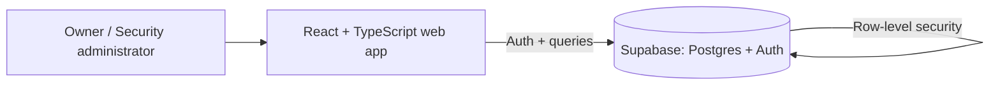

# SecureStart
# SecureStart

**Helps South African small professional firms find their cybersecurity and POPIA gaps, turn each gap into a tracked fix, and show exactly how their security is improving.**

| | |
|---|---|
| **Live app** | _add link after deploy (Tue 24 Nov)_ |
| **Stitch designs** | [Open the Stitch project](https://stitch.google.com/preview/6779133449834683870) (exports in [docs/designs/](./docs/designs/)) |
| **Loom pitch and demo** | _add link (Wed 25 Nov)_ |
| **Test logins** | _add owner and administrator accounts after deploy_ |

## The problem

Small accounting, law and medical practices hold client personal information but have no security team. Under POPIA every security compromise must be reported, the Information Regulator is moving into active enforcement, and most firms track their security in a spreadsheet, if at all. Full detail and sources: [BUSINESS.md](./BUSINESS.md).

## What SecureStart does

A firm answers a guided assessment built on CIS Controls v8 (Implementation Group 1) and mapped to POPIA security requirements. Each "no" or "partly" answer becomes a prioritised risk with an owner, a due date and a status. A dashboard shows a transparent score and how it improves as risks are resolved.

SecureStart does not scan systems or run automated penetration tests, and it does not give legal advice.

## Must features

1. **Authentication and roles:** business owner and security administrator, with permissions enforced in the database.
2. **Guided assessment:** questionnaire with transparent scoring.
3. **Findings and remediation tracking:** risks created from assessment answers, tracked from open to resolved.
4. **Risk dashboard:** score, top risks and progress over time.

## Tech stack

Planned stack, update if anything changes:

- **Frontend:** React, TypeScript, Vite, Tailwind CSS
- **Backend and database:** Supabase (hosted Postgres, Auth, row-level security policies)
- **Testing:** Vitest and Testing Library
- **CI:** GitHub Actions running lint, typecheck, tests and build on every pull request
- **Hosting:** _add host after deploy_

## Architecture



Roles are stored in the database and every table is protected by row-level security policies, so permissions are enforced on the backend and not only in the interface.

## Run it locally

```bash
git clone https://github.com/codingwithlebo/SecureStart.git
cd SecureStart
npm install
cp .env.example .env   # add your Supabase URL and anon key
npm run dev
```

## Run the tests

```bash
npm run lint
npm run typecheck
npm test
npm run build
```

## Documentation

- [BUSINESS.md](./BUSINESS.md): problem, customer, solution, impact, business model, go-to-market, competition
- [docs/PRD.md](./docs/PRD.md): product requirements
- [docs/designs/](./docs/designs/): Stitch design exports
- [IMPLEMENTATION_PLAN.md](./IMPLEMENTATION_PLAN.md): build plan

## Screenshots

_Add desktop and mobile screenshots after the first deploy._

## Known issues

_List any open issues here before submission._

## Author

Malebo Nkuna, [GitHub](https://github.com/codingwithlebo) · [LinkedIn](https://linkedin.com/in/malebo-n-b1b872376)
